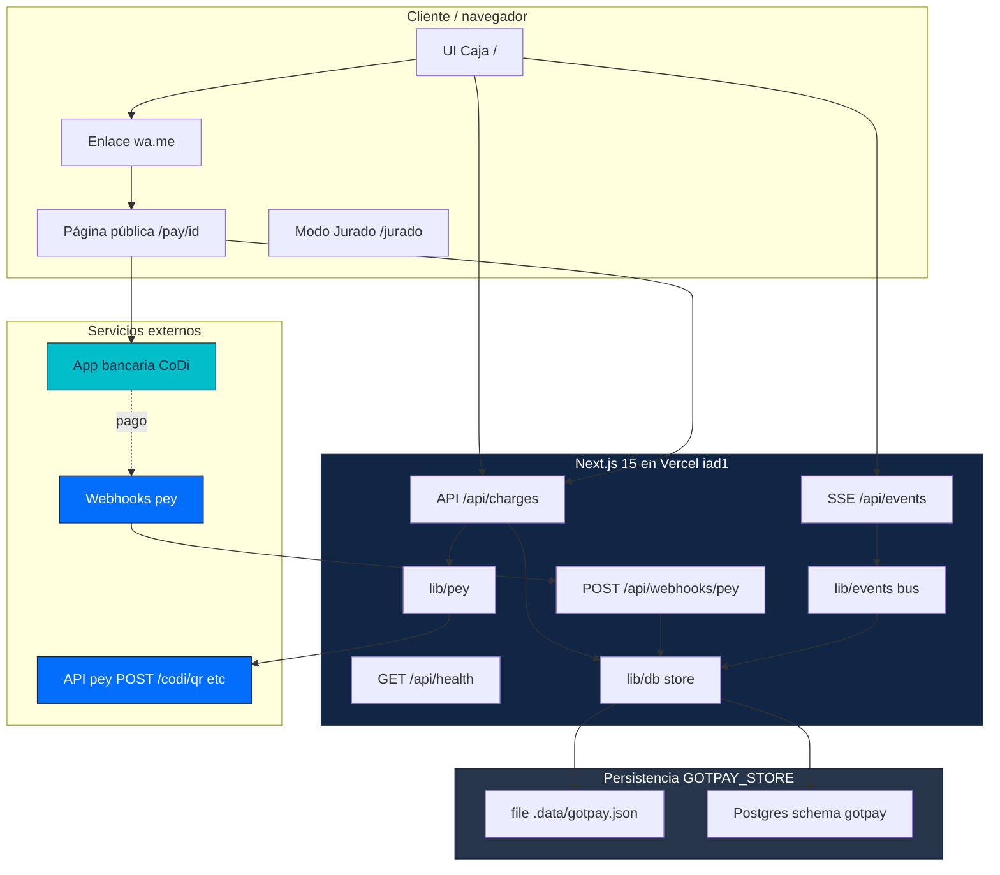
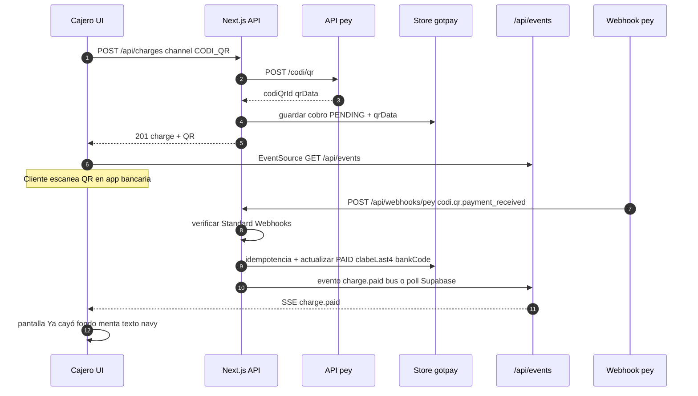
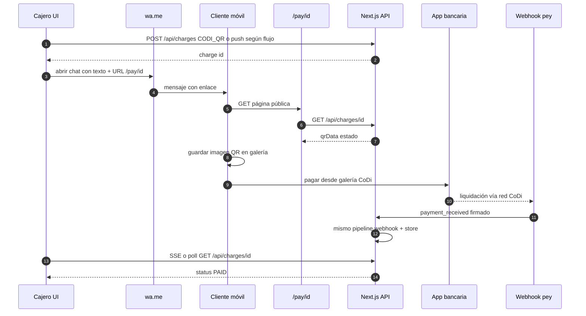
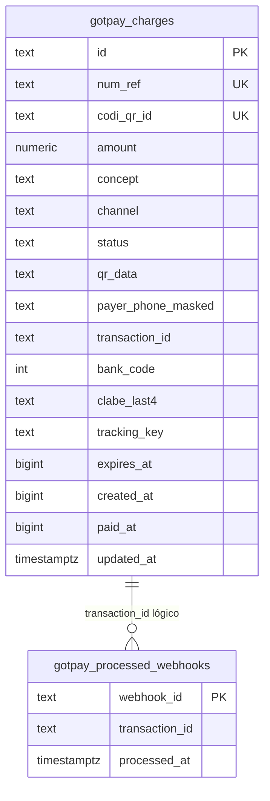

# Arquitectura — GotPay

Documentación técnica de alto nivel para el repositorio [GotPay](https://github.com/jahdielrosalesjacobo3-byte/GotPay). Describe lo que está implementado hoy: Next.js en Vercel, store `file` o Supabase, integración con la API de pey y confirmación en vivo en la caja.

## Vista de componentes

## Secuencia: cobro QR en mostrador

## Secuencia: WhatsApp y página pública

## Tiempo real: SSE y respaldo

| Modo store | Comportamiento |
|------------|----------------|
| `file` | Bus en memoria del mismo proceso; suscriptores a `/api/events` reciben `charge.*` y `heartbeat`. |
| `supabase` | Sin bus compartido entre instancias serverless: el stream hace **poll** periódico a Postgres por `updated_at` y emite eventos; el cliente también puede consultar `GET /api/charges/[id]`. |

Eventos tipados (`GotPayRealtimeEvent`): `charge.created`, `charge.paid`, `charge.paid_late`, `charge.expired`, `heartbeat`.

## Modelo de datos (`gotpay`)

Migración de referencia: `supabase/migrations/20261114154000_gotpay_store_init.sql`. El contrato TypeScript es `GotPayCharge` en `src/types/gotpay.ts`.

### Entidad `gotpay.charges`

| Campo (SQL) | Campo (TS) | Notas |
|-------------|------------|--------|
| `id` | `id` | ULID del cobro en GotPay |
| `num_ref` | `numRef` | Referencia numérica para pey |
| `codi_qr_id` | `codiQrId` | ID del QR en pey |
| `amount` | `amount` | MXN, positivo |
| `concept` | `concept` | Concepto de cobro |
| `channel` | `channel` | `CODI_QR`, `CODI_PUSH`, `PAYMENT_LINK` |
| `status` | `status` | `CREATED`, `PENDING`, `PAID`, `EXPIRED`, `PAID_LATE`, `CANCELLED` |
| `qr_data` | `qrData` | Payload para renderizar QR |
| `payer_phone_masked` | `payerPhoneMasked` | Solo máscara, nunca 10 dígitos en claro en respuestas API |
| `transaction_id` | `transactionId` | Id de transacción CoDi cuando aplica |
| `bank_code` | `bankCode` | Código de banco del pagador |
| `clabe_last4` | `clabeLast4` | **Solo últimos 4 dígitos** de CLABE |
| `tracking_key` | `trackingKey` | Clave de rastreo cuando existe |
| `expires_at` | `expiresAt` | Unix ms |
| `created_at` | `createdAt` | Unix ms |
| `paid_at` | `paidAt` | Unix ms opcional |

### Entidad `gotpay.processed_webhooks`

Registra `webhook_id` (cabecera Standard Webhooks) y `transaction_id` para **idempotencia**: un mismo pago no debe procesarse dos veces aunque pey reintente el webhook.

### Rol `gotpay_server`

Rol Postgres de mínimo privilegio: `SELECT/INSERT/UPDATE` en `charges`, `SELECT/INSERT` en `processed_webhooks`, `search_path` fijado a `gotpay`. La aplicación en Vercel se conecta con `SUPABASE_DB_URL` (solo servidor, nunca expuesto al cliente).

## Capas en el repositorio

| Ruta | Responsabilidad |
|------|-------------------|
| `src/app/api/**` | Rutas HTTP y webhook |
| `src/app/page.tsx`, `src/app/pay/**`, `src/app/jurado/**` | UI de caja, página pública y Modo Jurado |
| `src/lib/pey/**` | Cliente HTTP pey y verificación de webhooks |
| `src/lib/db/**` | Store file/Postgres, lifecycle de cobros |
| `src/lib/events/**` | Bus SSE local |
| `src/types/gotpay.ts` | Contratos compartidos |

## Referencias cruzadas

- [Seguridad](./SECURITY.md)  
- [API HTTP](./API.md)